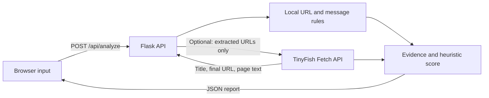

# Trapdoor

**Don't just detect the trap. Expose it.**

Trapdoor is an evidence-first phishing investigation lab. Paste a suspicious URL, email, or SMS to review the warning patterns its local rules detect and the reasons behind them.

> This repository contains a working MVP. The score is a transparent heuristic, not a probability. When enabled, TinyFish fetches public URLs and returns page evidence; Trapdoor does not submit forms or treat a failed fetch as a safe result. This is not a domain reputation service.

## What works

- Flask web application with URL, email, and SMS input modes.
- URL and email checks for mixed-script and punycode lookalikes, invisible/bidi characters, Unicode slash confusion, backslash and `@` parser confusion, decimal/octal/hex IPs, nested and encoded redirects, risky file extensions, long subdomains, display-name spoofing, header mismatches, and payment-change language.
- Message checks for urgency, credential requests, threats, and payment context.
- Deduplicated weighted findings, a bounded 0–100 heuristic score, a prominent action recommendation, readable evidence, and explicit coverage limits.
- Responsive interface with safe demonstration examples and an explicit unknown reputation state.
- Optional TinyFish Fetch API integration for rendered page title, final URL, description, and text excerpt. A cross-site final redirect or a nonofficial brand sign-in title adds explainable findings.
- JSON API at `POST /api/analyze` and health endpoint at `GET /api/health`.

## Run locally

Python 3.10 or newer is recommended.

```powershell
py -m venv .venv
.\.venv\Scripts\Activate.ps1
python -m pip install -r requirements.txt
python app.py
```

Then open [http://127.0.0.1:5000](http://127.0.0.1:5000). On macOS or Linux, activate the environment with `source .venv/bin/activate`.

The local rules work without an API key. To enable TinyFish, copy `.env.example` to `.env`, add a key from [TinyFish API keys](https://agent.tinyfish.ai/api-keys), then restart Trapdoor:

```powershell
Copy-Item .env.example .env
# Open .env and replace the placeholder with your key.
python app.py
```

The page shows whether a key is configured. Live inspection is selected by default when you submit an investigation; you can turn it off before analyzing. Only extracted URLs are sent to TinyFish, up to three per scan. Pasted email and SMS text remains in Trapdoor. Because a URL can contain private query values, review the URL before using the live check. The check fetches page content without clicking, submitting forms, or downloading files. The app skips non-web schemes, private IP addresses, reserved demo domains, credentialed URLs, and nonstandard ports. TinyFish documents its Fetch endpoint, authentication, request format, and URL limits in its [Fetch API reference](https://docs.tinyfish.ai/fetch-api/reference).

## Deploy on Netlify with GitHub

Netlify serves the web interface and the `/api/*` Netlify Function forwards requests to the Flask service. Netlify Functions do not run this Flask application directly, so the Python service must also be deployed. The included `render.yaml` configures a free Render web service from the same GitHub repository.

1. Import `shubhmroot/trapdoor` at [Netlify](https://app.netlify.com/start). Netlify reads `netlify.toml` and builds the static interface and API proxy automatically.
2. Create a Render Blueprint from the same repository at [Render](https://dashboard.render.com/blueprints). Render reads `render.yaml`; deploy the `trapdoor-api` service.
3. In Render, open the new service's environment settings and copy the generated `TRAPDOOR_PROXY_TOKEN`. In Netlify, open **Project configuration → Environment variables** and set both `TRAPDOOR_BACKEND_URL` (the Render service HTTPS URL, such as `https://trapdoor-api.onrender.com`) and `TRAPDOOR_PROXY_TOKEN` (the generated secret). Save and redeploy the Netlify site. The token prevents direct public calls to the paid-fetch backend; Netlify also limits the API proxy to 10 requests per IP per minute.
4. In Render, set `TINYFISH_API_KEY` under the `trapdoor-api` service's environment variables if you have a TinyFish key. Keep this secret out of GitHub. Without it, the local rules still work and TinyFish reports that live inspection is not configured.

The free Render service may sleep while idle, so the first analysis after a quiet period can take longer while it wakes. Later pushes to `main` trigger deploys on both linked services. Netlify environment variables are available to its function at runtime, and the backend URL is validated as HTTPS before forwarding.

## API example

```powershell
Invoke-RestMethod -Uri http://127.0.0.1:5000/api/analyze `
  -Method Post -ContentType 'application/json' `
  -Body '{"text":"URGENT: verify your account at http://paypal-security-check.example.test/login","input_type":"sms"}'
```

The response includes `verdict`, `risk_score`, `score_type`, `recommended_action`, `summary`, `findings`, extracted URL/email data, reputation status, `live_inspection`, and coverage notes. Send `"tinyfish_enabled": true` to request a live fetch; omit it or set it to `false` to run local checks only. TinyFish status is reported as `checked`, `unavailable`, `not_configured`, `skipped`, or `not_requested`. A failed or skipped check never counts as reassuring evidence. Possible verdicts are `CRITICAL_RISK`, `HIGH_RISK`, `MEDIUM_RISK`, `LOW_RISK`, and `NO_SIGNALS_FOUND`.

## Safe demo cases

Use the included examples in the interface:

- **Routine update:** ordinary library notice, expected to produce no matched warning rules.
- **Urgent account alert:** uses the reserved `.test` domain and warning language to demonstrate message and URL rules. It is illustrative and not a live site.

Other useful manual inputs include `http://192.0.2.10/sign-in` (reserved documentation IP) and a normal reminder with no link. Never use real credentials or send sensitive personal information to a demo.

## How the score works

Each distinct rule contributes its documented weight in `app.py`. The score is capped at 100. Bands are 0 = no obvious warning signs, 1–24 = caution, 25–49 = suspicious, 50–74 = high risk, and 75+ = strong warning signs. These are matched-signal points, not calibrated probabilities. The rules are deterministic heuristics, not a machine-learning model; adding patterns is regression-tested against the supplied examples but does not constitute model training or prove real-world accuracy. TinyFish can add findings for a cross-site final redirect and a page title that pairs a known brand with sign-in or account language on a nonofficial domain. Findings retain their evidence and source so users can review each signal. Missing reputation data stays `not_checked`; it is not treated as a benign signal.

Run the regression benchmark with `python -m unittest -v`. It covers safe traps and suspicious URL/email examples, including Unicode, parser confusion, IP notation, encoded redirects, headers, payment-change language, TinyFish URL safety checks, API response handling, and expected decisions. TinyFish calls are mocked in automated tests. The benchmark is a small hand-built test set, not a representative accuracy study.

## Project structure

```text
trapdoor/
├── app.py                 # Flask routes and explainable analysis rules
├── requirements.txt
├── netlify.toml           # Netlify static build + serverless API proxy
├── netlify_build.py       # Exports the Flask template and assets for Netlify
├── netlify/functions/     # Netlify API proxy function
├── render.yaml            # Flask API service for Render
├── README.md
├── .env.example
├── .gitignore
├── templates/
│   └── index.html
└── static/
    ├── style.css
    └── script.js
```

## Request flow



## Architecture and security boundaries

The browser sends pasted text to the local Flask endpoint, where deterministic rules run. If live inspection is enabled and a TinyFish key is configured, Trapdoor sends up to three eligible extracted URLs to TinyFish Fetch and displays the returned page title, final URL, description, and excerpt. It never sends the full pasted message. TinyFish fetches remotely and returns page content; it does not establish domain reputation, sender identity, or whether a request is legitimate. Some attacks depend on the claimed company, known sender, and conversation history, which page fetching cannot establish. Automated tests mock provider responses and do not contact live sites. Keep API secrets in `.env`; `.gitignore` excludes it.

AI-written explanations remain future work; any model should explain findings returned by the rules and must not manufacture evidence.

## Team

- Shubham Raj — project lead
- Priyam Garg
- Rishabh Choudhary

## Next steps

- Calibrate rules against a documented, harmless evaluation set.
- Add a trusted reputation source with timestamps and explicit unavailable/error states.
- Expand the TinyFish evidence checks against a larger labeled set and measure false positives.
- Add AI-written summaries grounded only in detector output.
- Add report export and deployment after security and privacy review.

## License

No license has been selected. Add one only after the team decides how the project may be reused.


