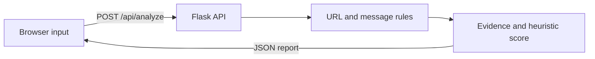

# Trapdoor

**Don't just detect the trap. Expose it.**

Trapdoor is an evidence-first phishing investigation lab. Paste a suspicious URL, email, or SMS to review the warning patterns its local rules detect and the reasons behind them.

> This repository contains a working MVP. The score is a transparent heuristic, not a probability. External reputation checks, AI explanations, and TinyFish browsing are not implemented in this version. No submitted URL is opened or fetched.

## What works

- Flask web application with URL, email, and SMS input modes.
- URL and email checks for mixed-script and punycode lookalikes, invisible/bidi characters, Unicode slash confusion, backslash and `@` parser confusion, decimal/octal/hex IPs, nested and encoded redirects, risky file extensions, long subdomains, display-name spoofing, header mismatches, and payment-change language.
- Message checks for urgency, credential requests, threats, and payment context.
- Deduplicated weighted findings, a bounded 0–100 heuristic score, a prominent action recommendation, readable evidence, and explicit coverage limits.
- Responsive interface with safe demonstration examples and an explicit unknown reputation state.
- JSON API at `POST /api/analyze` and health endpoint at `GET /api/health`.

## Run locally

Python 3.10 or newer is recommended.

```powershell
py -m venv .venv
.\.venv\Scripts\Activate.ps1
python -m pip install -r requirements.txt
python app.py
```

Then open [http://127.0.0.1:5000](http://127.0.0.1:5000). On macOS or Linux, activate the environment with `source .venv/bin/activate`.

No `.env` file or API key is required to run the MVP. The `.env.example` file documents that external providers are not configured.

## API example

```powershell
Invoke-RestMethod -Uri http://127.0.0.1:5000/api/analyze `
  -Method Post -ContentType 'application/json' `
  -Body '{"text":"URGENT: verify your account at http://paypal-security-check.example.test/login","input_type":"sms"}'
```

The response includes `verdict`, `risk_score`, `score_type`, `recommended_action`, `summary`, `findings`, extracted URL/email data, reputation status, and coverage notes. Possible verdicts are `CRITICAL_RISK`, `HIGH_RISK`, `MEDIUM_RISK`, `LOW_RISK`, and `NO_SIGNALS_FOUND`. A clean result says no obvious warning signs matched and tells the user it is reasonable to continue if the link or email was expected and matches the intended sender or site. It also states that page content and reputation were not checked.

## Safe demo cases

Use the included examples in the interface:

- **Routine update:** ordinary library notice, expected to produce no matched warning rules.
- **Urgent account alert:** uses the reserved `.test` domain and warning language to demonstrate message and URL rules. It is illustrative and not a live site.

Other useful manual inputs include `http://192.0.2.10/sign-in` (reserved documentation IP) and a normal reminder with no link. Never use real credentials or send sensitive personal information to a demo.

## How the score works

Each distinct rule contributes its documented weight in `app.py`. The score is capped at 100. Bands are 0 = no obvious warning signs, 1–24 = caution, 25–49 = suspicious, 50–74 = high risk, and 75+ = strong warning signs. These are matched-signal points, not calibrated probabilities. The rules are deterministic heuristics, not a machine-learning model; adding patterns is regression-tested against the supplied examples but does not constitute model training or prove real-world accuracy. Findings retain their evidence and source so users can review each signal. Missing reputation data stays `not_checked`; it is not treated as a benign signal.

Run the regression benchmark with `python -m unittest -v`. It covers safe traps and suspicious URL/email examples, including Unicode, parser confusion, IP notation, encoded redirects, headers, payment-change language, and the user's expected decision for clean, caution, and high-risk results. It is a small hand-built test set, not a representative accuracy study.

## Project structure

```text
trapdoor/
├── app.py                 # Flask routes and explainable analysis rules
├── requirements.txt
├── README.md
├── .env.example
├── .gitignore
├── templates/
│   └── index.html
└── static/
    ├── style.css
    └── script.js
```

## Request flow



## Architecture and security boundaries

The browser sends pasted text to the local Flask endpoint. The analysis code extracts URLs and applies deterministic rules. It does not perform DNS lookups, follow redirects, fetch page content, inspect QR images or attachments, query domain age/reputation, or detect content swapped after delivery. Some attacks depend on the claimed company, known sender, conversation history, or page content; this edition cannot establish that context. Keep these boundaries in place if adding live lookups later; remote URL fetching needs isolation and strict controls to avoid server-side request forgery.

TinyFish and other external intelligence are future integrations. Add them only after reviewing the provider's current API documentation, terms, and credentials. Keep secrets in a local `.env` file, never commit that file, and never claim provider evidence until the integration actually returns it. AI explanations are also future work; any model should only explain findings returned by the rules and must not manufacture evidence.

## Team

- Shubham Raj — project lead
- Priyam Garg
- Rishabh Choudhary

## Next steps

- Calibrate rules against a documented, harmless evaluation set.
- Add a trusted reputation source with timestamps and explicit unavailable/error states.
- Consider TinyFish web evidence after API access and safe-fetch design are confirmed.
- Add AI-written summaries grounded only in detector output.
- Add report export and deployment after security and privacy review.

## License

No license has been selected. Add one only after the team decides how the project may be reused.

